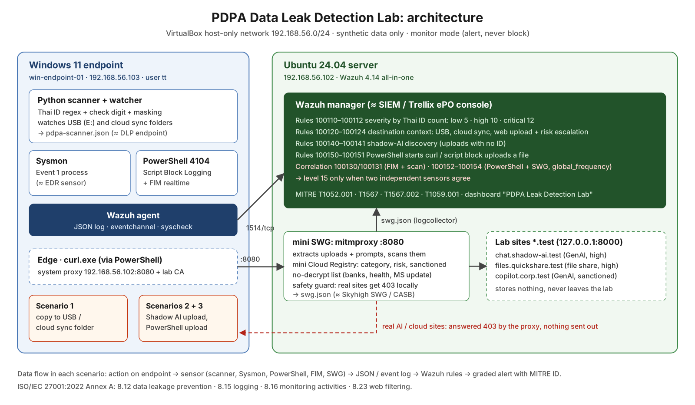

# Case study: PDPA Data Leak Detection Lab

**Detecting Thai personal data leaving an endpoint, built in 7 days with open-source tools.**
Synthetic data only. Monitor mode only.

## The problem

Thailand's PDPA makes an organisation answer for personal data that leaves its control.
The most common identifier in Thai records is the 13-digit national ID. A data leak
prevention (DLP) product has to find these numbers in files, decide how serious a leak is,
and tell an analyst only when it matters, across three common exit routes:

1. Copying a file to a USB drive or a cloud sync folder
2. Uploading a file, or pasting text, into an unsanctioned AI service ("Shadow AI")
3. A PowerShell script sending a file out

I built the same mechanisms that commercial DLP, SWG/CASB and EDR products use, to
understand how they work inside and where they go wrong.

## What I built

| Lab component | What it does | Commercial equivalent |
| --- | --- | --- |
| Python scanner | Finds Thai IDs in .txt .csv .xlsx .docx (UTF-8 and TIS-620), validates the check digit, masks the number | DLP endpoint agent (Trellix DLP) |
| mitmproxy mini SWG + Cloud Registry | Inspects web uploads and prompts, rates destinations by category, risk and sanction status, skips TLS inspection for banking and health | SWG / CASB (Skyhigh) |
| Sysmon + PowerShell Script Block Logging | Process and script telemetry on the endpoint | EDR sensor (Trend Micro) |
| Wazuh manager | Rules, severity, correlation, MITRE mapping, dashboard | SIEM / management console (Trellix ePO) |

Two VMs on one PC (VirtualBox host-only network): a Windows 11 endpoint and an Ubuntu
server running Wazuh 4.14 and the SWG. Every upload test goes to lab-only `*.test` sites.

## Results

**The check digit removes most false alarms.** On 1,000 synthetic files (403 with
real-format IDs, 360 with random 13-digit business numbers, 237 clean):

| Detection | False-positive files that would page an analyst | Missed files |
| --- | --- | --- |
| Regex only | 292 | 0 |
| Regex + Thai ID check digit | **0** | 0 |

**End to end, every leak was caught and every page was correct.** All 1,000 files were
uploaded from the endpoint through the SWG and each Wazuh alert was matched back to its
file:

| Measure | Result |
| --- | --- |
| Files with real-format IDs that raised an alert | 403 / 403 (recall 100%) |
| Alerts that paged an analyst (10+ IDs) | 164, all correct (precision 100%) |
| Decoys with a number that passes the check digit by chance | 270, all kept at a low level |

## Severity design

| Thai IDs in one file | Severity | Wazuh level |
| --- | --- | --- |
| 1–9 | low | 5 (7 when sent to unsanctioned AI) |
| 10–49 | high | 10 (12 when sent to an unsanctioned high-risk site) |
| 50+ | critical | 12 |
| Two independent sensors agree | confirmed | 15 (dashboard "Critical") |

A random 13-digit number passes the check digit about 1 time in 10, so false positives
cannot be removed completely. The thresholds keep every one of them below the level that
pages an analyst. Only incidents confirmed by two sensors (file integrity monitoring plus
content scan, or PowerShell telemetry plus the SWG) reach level 15.

## Problems I had to solve

| Problem | Cause | Fix |
| --- | --- | --- |
| 292 false high/critical alerts from regex | Order numbers and tracking codes are also 13 digits | Thai ID check digit + count thresholds |
| File integrity monitoring silent on the USB stick | FAT32 has no ACL; Wazuh's default checks fail and drop the event | Check only size, mtime and hash on that folder |
| Empty user name in alert text | Wazuh's JSON decoder maps `user` to the static field `dstuser` | Use `$(dstuser)`, verify with wazuh-logtest |
| First SWG alerts never appeared | The log file did not exist when the manager started; logcollector then read from its end | Create the file before restarting the manager |
| PowerShell + SWG correlation never fired | Wazuh correlates within one agent by default; the two events come from different agents | `<global_frequency />`, rules in both directions |
| Risk of sending test data to real AI sites | A proxy normally connects upstream before the addon decides | Lazy upstream connection + a safety guard that answers real-site uploads with 403 |

## Why monitor mode

DLP is rolled out to customers in monitor mode first: alert, measure false positives,
tune, then enable blocking. The lab follows the same order. The numbers above are the
evidence a customer would ask for before turning on blocking.

## Standards mapping

ISO/IEC 27001:2022 Annex A: 8.12 Data leakage prevention (scanner, three scenarios),
8.15 Logging (JSON events with masked values only), 8.16 Monitoring activities (Wazuh
rules, endpoint telemetry, dashboard), 8.23 Web filtering (mini SWG, cloud registry,
TLS inspection bypass list). MITRE ATT&CK: T1052.001, T1567, T1567.002, T1059.001.

## What I would do next

- Join correlated events on the file hash instead of only time, so "the same file" is proven
- Enable blocking for critical uploads to unsanctioned AI once monitor-mode numbers hold
- PDF support in the scanner, and a local LLM that summarises an incident from masked data

## Demo video (2–3 minutes) shot list

1. Architecture diagram, 15 s: three exit routes, one SIEM
2. USB copy of a file with 120 synthetic IDs, then alerts 100120 and 100130 with T1052.001, 30 s
3. Edge on `chat.shadow-ai.test`: paste a prompt with IDs, upload a file, then 100124 and 100123, 40 s
4. curl to chatgpt.com answered 403 by the safety guard, 10 s
5. PowerShell upload, then 100150, 100151 and confirmed 100152 at level 15, 30 s
6. Dashboard and the 1,000-file numbers, 20 s

Code and setup guides: [github.com/tmaetasit/pdpa-leak-detection-lab](https://github.com/tmaetasit/pdpa-leak-detection-lab)
